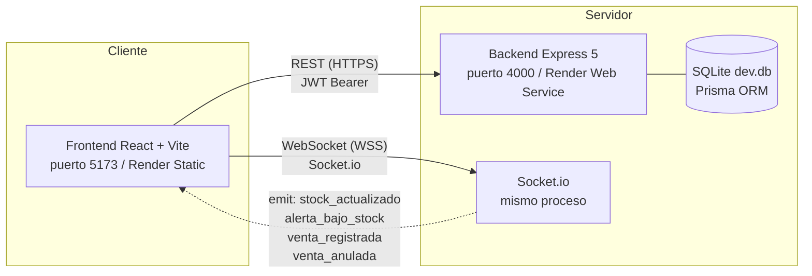
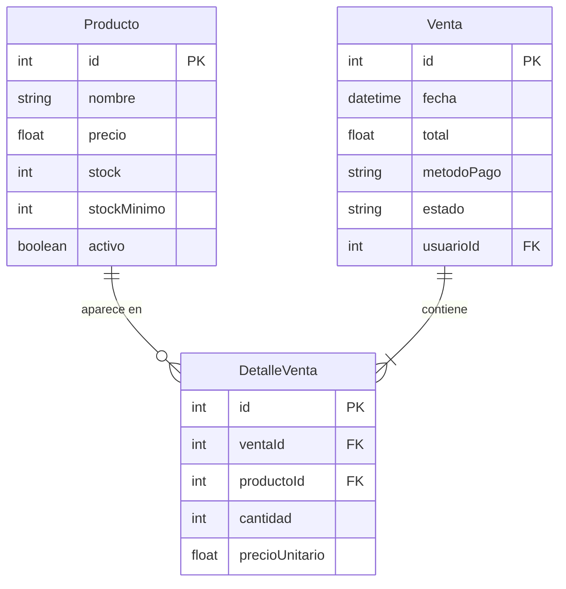
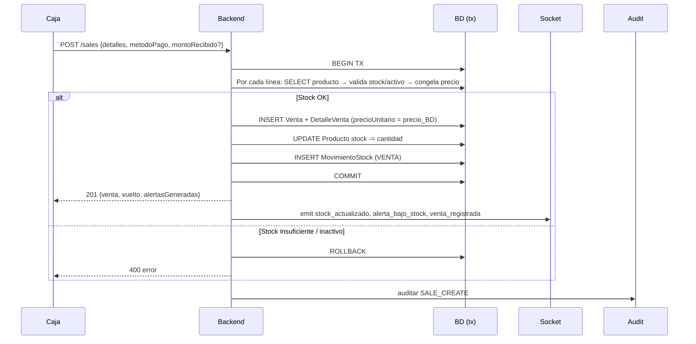
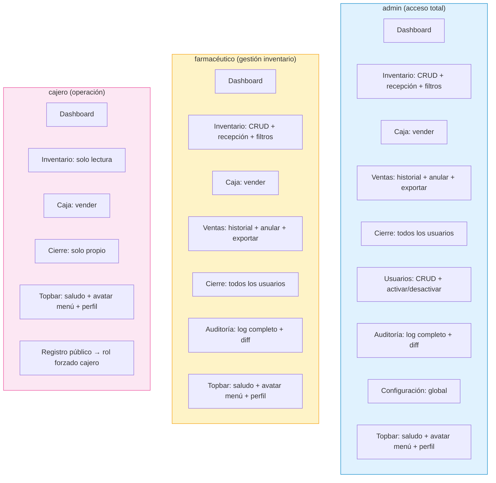

# DIAGRAMAS.md — Diagramas simplificados para slides (copia y pega en mermaid.live)

> Cada bloque está listo para usar en <https://mermaid.live>. Ajusta tema/tamaño y descarga como **PNG** o **SVG** para PowerPoint.

---

## 1. Arquitectura general (slide 3)

> Clave: **REST y WebSocket al mismo servidor (backend); front y back son orígenes distintos, por eso `CORS_ORIGIN`**, **backend árbitro**, **BD aislada**.

---

## 2. ER simplificado — solo Venta, DetalleVenta, Producto (slide 4)

> **Uso en slide**: 3 entidades + relaciones. La completa (7 tablas) queda como respaldo técnico.

---

## 3. Flujo de venta atómica — 6 pasos (slide 6)

> **Uso en slide**: 6 pasos caben en una diapositiva. La completa (con validación fuera de tx, agrupación de líneas, SELECT usuario dentro de tx, `req.io?.emit`, auditoría post-commit) queda como respaldo técnico.

---

## 4. Casos de uso por rol (slide 8)

> Basado en `README §9` y `front/src/App.jsx` (NAV con `puedeGestionarInventario`, `isAdmin`, `adminOnly`). Topbar implementado en `Topbar.jsx` con saludo dinámico, avatar, menú accesible (Escape, flechas, Home/End).

---

## Nota de exportación

1. Abre cada bloque en <https://mermaid.live>
2. Ajusta **Theme** (default / dark / forest / neutral) y **Scale**
3. **Download → PNG** (para slides) o **SVG** (escalable)
4. Inserta en PowerPoint / Google Slides / Canva