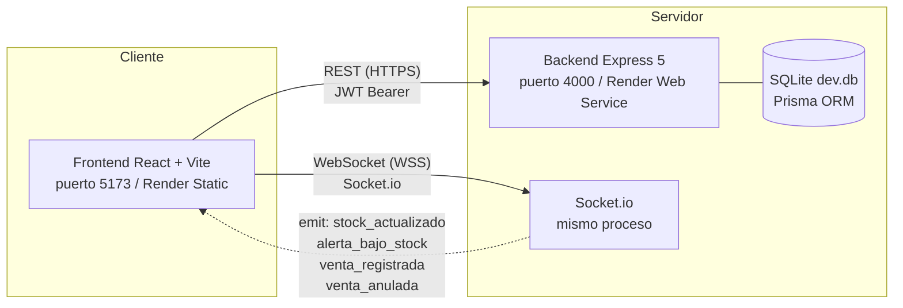
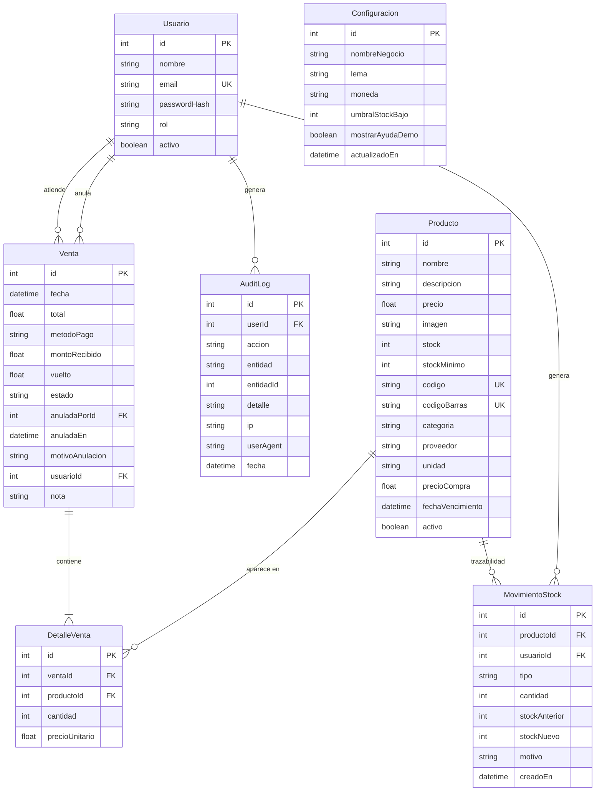
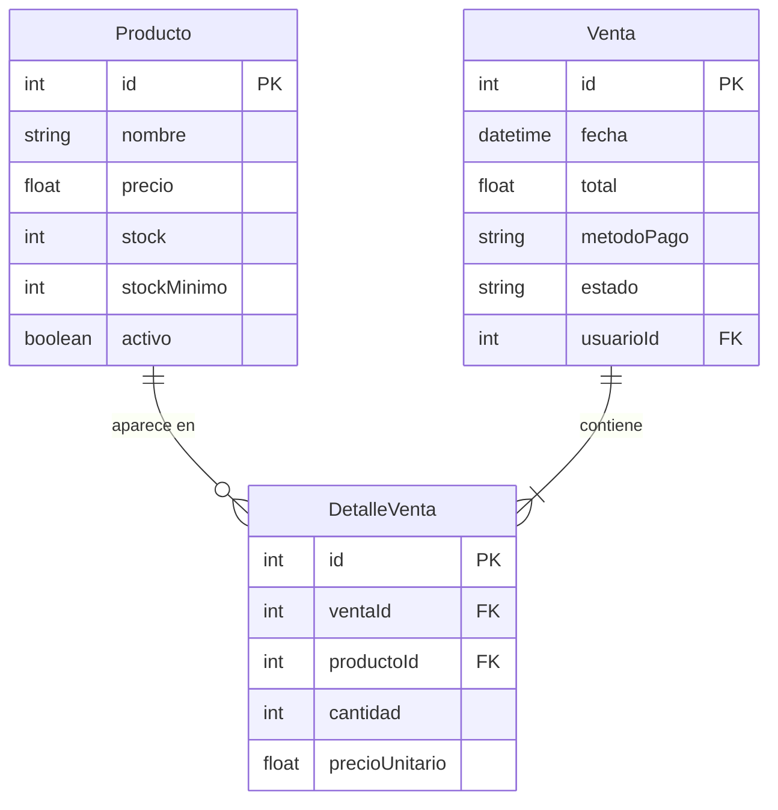
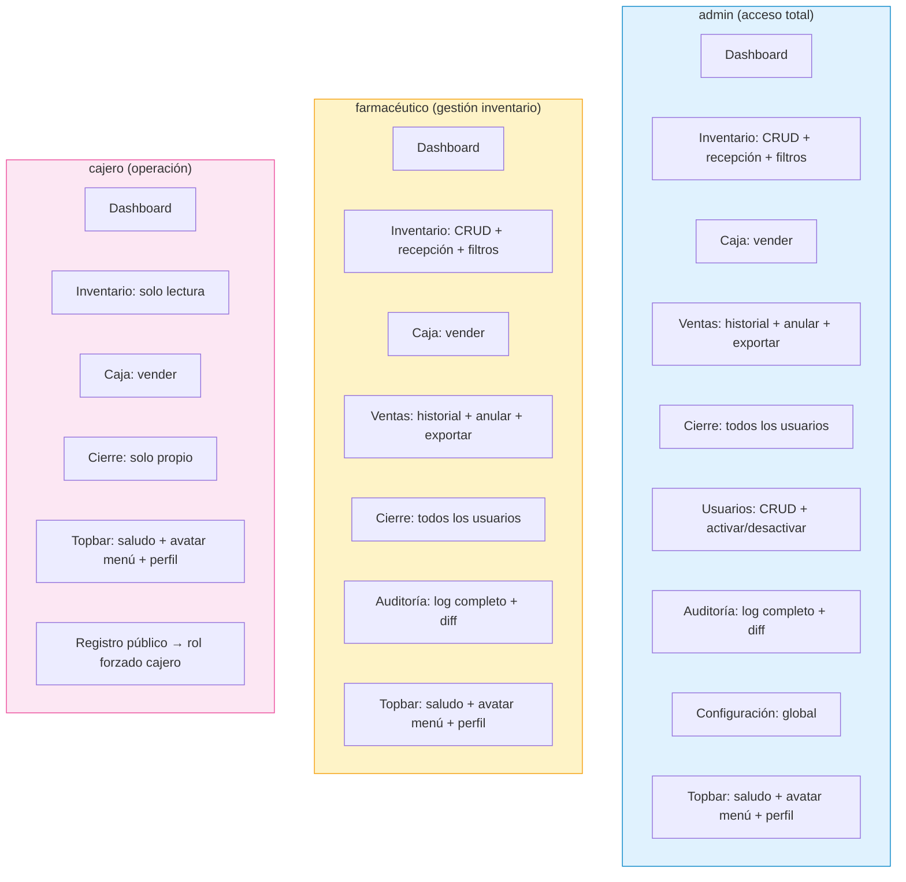
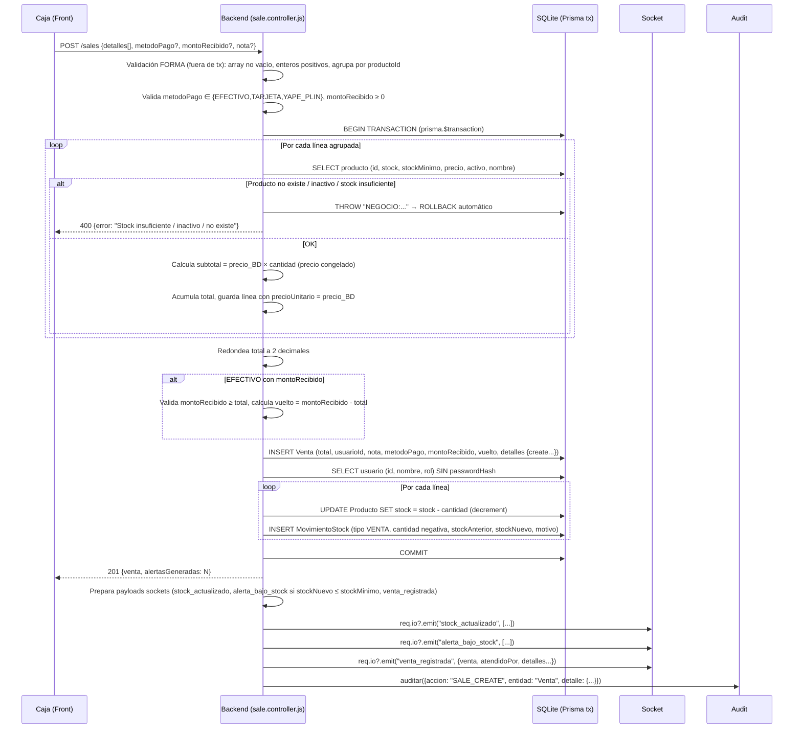
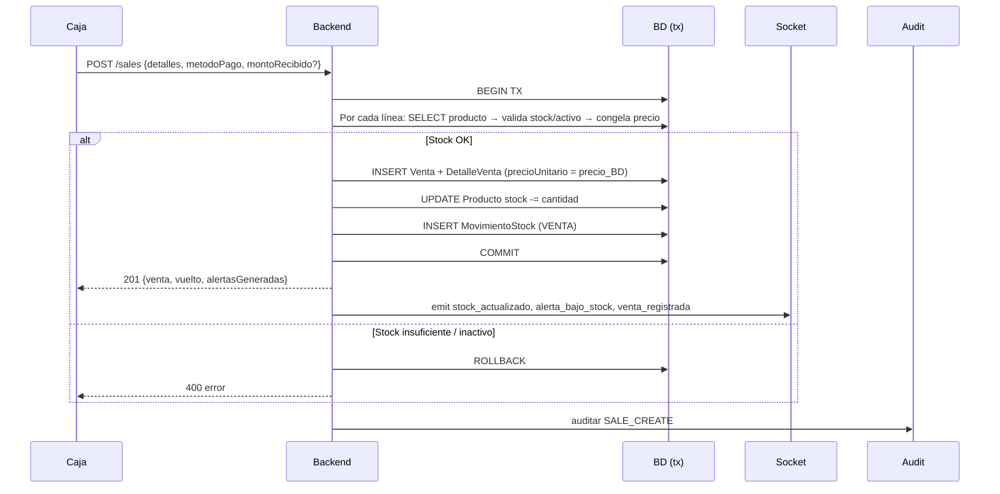

# PRESENTACION.md — Guía para armar la presentación (PowerPoint) de Nova Salud

> Este documento **no** es la presentación. Es una **guía de estructura y contenido** para que armes tus diapositivas (PowerPoint / Google Slides / Canva) en 15–20 minutos de defensa oral. Usa el README como fuente de datos técnicos; este archivo te dice **qué poner en cada slide** y **qué enfatizar**.

---

## 1. Principios de la presentación

| Principio | Acción |
|---|---|
| **Audiencia = evaluador técnico** | Menos onboarding, más decisiones de arquitectura y resultados. |
| **Tiempo: ~12 min slides + 5 min demo + 3 min preguntas = 20 min** | 12–14 slides máx. Una idea por slide. |
| **Slides first, demo second** | Las slides contextualizan; la demo valida. Si la demo falla, las slides sostienen la nota. |
| **Evidencia > promesa** | Cada claim técnico → muestra código, test, log o captura. |
| **Storytelling: problema → solución → evidencia → límites → roadmap** | Estructura clásica de defensa de proyecto. |

---

## 2. Estructura sugerida (12–14 slides)

| # | Slide | Qué mostrar (contenido) | Fuente en README / código | Diagrama | Tiempo aprox. |
|---|---|---|---|---|---|
| 1 | **Portada** | Nombre del proyecto, curso, fecha, autor, stack (iconos) | README §1, §18 | — | 30 s |
| 2 | **Problema & Objetivo** | "Botica necesita inventario + ventas en tiempo real, roles, atomicidad, alertas" | README §1, enunciado | — | 45 s |
| 3 | **Arquitectura general** | Diagrama: Front (React/Vite) ↔ Back (Express/Socket.io) ↔ SQLite (Prisma) | README §1 (mapa mental) | **Arquitectura** | 1:15 min |
| 4 | **Modelo de datos (ER)** | 7 tablas con campos y relaciones reales (Usuario, Producto, Venta, DetalleVenta, MovimientoStock, Configuración, AuditLog) | README §12, `back/prisma/schema.prisma` | **ER** | 1:15 min |
| 5 | **Autenticación & Autorización** | JWT stateless (1 h), bcryptjs, roles (admin/farma/cajero), middlewares compuestos | README §10 (auth), §16 | — | 1 min |
| 6 | **Venta atómica (core)** | Transacción exacta del controller: validación forma → agrupa líneas → tx interactiva (lee producto, valida stock/activo, congela precio, crea venta + líneas, descuenta stock, crea movimientos) → commit → emite sockets + auditoría | `back/src/controllers/sale.controller.js` | **Flujo de venta** | 1:30 min |
| 7 | **Tiempo real (Socket.io)** | Eventos: `stock_actualizado`, `alerta_bajo_stock`, `venta_registrada`, `venta_anulada` — broadcast, read-only, `req.io?.emit` | README §11, `sale.controller.js` | — | 1 min |
| 8 | **Roles & UI (Casos de uso)** | Casos de uso por rol: admin (todo), farmacéutico (gestión inventario + ventas + auditoría), cajero (Dashboard, Inventario, Caja, Cierre) + Topbar saludo + avatar menú | README §9 | **Casos de uso** | 1 min |
| 9 | **Pruebas automatizadas** | **54 tests** `node:test` en `back/tests/critical.test.js` (auth, roles, ventas atómicas, stock, anulación, cierre, config, users, pagos, productos) — **pasando** + **captura obligatoria**: consola con `npm test` todo verde | README §10.1, `back/tests/critical.test.js` | — | 45 s |
| 10 | **Despliegue en Render** | 2 servicios (Web Service + Static Site), start command con seed, cold start, FS efímero, variables de entorno (incl. `CORS_ORIGIN` obligatorio) + **captura obligatoria**: dashboard Render con ambos servicios en **Live** (sin secretos) | README §13, §14 | — | 1 min |
| 11 | **Decisiones clave (defensa)** | Prisma 6/CommonJS, JWT stateless, backend árbitro, precio congelado, socket notificación-only, roles por recurso, bloqueo borrado con FK, sin Router, auditoría con diff | README §16 | — | 1:30 min |
| 12 | **Limitaciones honestas & Roadmap** | SQLite efímero, cold start, Prisma 6, sin React Router, CORS configurado pero no rooms, sin Postgres | README §17 | — | 45 s |
| 13 | **Demo en vivo (script)** | Ver §3 abajo | — | — | 5 min |
| 14 | **Cierre / Preguntas** | Repo, contactos, QR al deploy | — | — | 1 min |

---

## 3. Script de demo en vivo (5 min)

| Paso | Acción | Qué dice el evaluador | Qué respondes |
|---|---|---|---|
| 1 | Abre **2 pestañas** en el front desplegado (Render) | "¿Esto es producción?" | "Sí, Render Free. Backend despierta en ~30 s (cold start)." |
| 2 | Login **admin** en ambas | — | "JWT 1h, stateless, sobrevive a reinicios." |
| 3 | Pestaña A → **Caja** → busca **"Ibuprofeno"** (stock 12, mínimo 20) → +2 → Cobrar (EFECTIVO, monto 20) | "¿El precio lo pone el front?" | "No, backend recalcula desde BD y congela precio en DetalleVenta." |
| 4 | Observa Pestaña B (Inventario): **stock Ibuprofeno 12→10**, toast rojo **"Reponer: Ibuprofeno"** (stockNuevo 10 ≤ mínimo 20) | "¿Cómo se enteró?" | "Socket.io `stock_actualizado` + `alerta_bajo_stock` broadcast (se dispara cuando stockNuevo ≤ stockMinimo tras la venta)." |
| 5 | Pestaña B → **Ventas**: ticket aparece **sin recargar** | "¿Y si abro Ventas en otra pestaña?" | "Mismo evento `venta_registrada`, todos lo reciben." |
| 6 | Pestaña A → **Ventas** → **Anular** (motivo "error") → stock repone, ticket marcado ANULADA | "¿Hay rollback real?" | "Transacción: repone stock, crea AuditLog SALE_VOID, 409 si ya anulada." |
| 7 | **Registro de cajero** (pestaña nueva) → completa nombre/email/pass → entra directo (login automático) → ve Dashboard, Inventario (solo lectura), Caja, Cierre; **no ve** Ventas, Auditoría, Usuarios, Config | "¿El front oculta o el back?" | "Ambos: front filtra tabs (`puedeGestionarInventario`, `isAdmin`), back responde 403 si insiste por API. Registro público fuerza rol `cajero`." |
| 8 | **Cierre de caja** (admin) → filtra fecha/usuario → totales por método, efectivo esperado, anuladas → **Imprimir** (1 página) | "¿Imprime bien?" | "CSS `@media print` aislado: oculta todo salvo modal ticket, fuerza B/N, `page-break-inside: avoid`." |

> **Tip:** 30 s antes de la defensa, abre la URL del backend en Render para "calentarlo" y **registra un cajero** en ese momento (el registro público crea el usuario y loguea automático). Así tienes el cajero listo para el paso 7 sin perder tiempo.

---

## 4. Qué **NO** poner en las slides

| Evita | Por qué |
|---|---|
| Glosario de Git/npm/terminal (README §2) | Evaluador lo sabe. |
| Pasos de clonar/instalar `.env` (README §5–§8) | Es onboarding, no defensa. |
| Tabla completa de 50+ endpoints (README §10) | Muestra solo los 3–4 críticos (login, venta, stock, cierre). |
| Troubleshooting (README §15) | Solo si te preguntan "¿y si falla X?". |
| Tono "Marlon, Brat" | Cambia a "el equipo / nosotros". |
| Capturas de código extensas | Usa diagramas, bullets, 1–2 líneas de código clave. |

---

## 5. Diagrama sugerido para slide 3 (Arquitectura)



> Si no usas Mermaid, dibuja cajas y flechas en PowerPoint (Insert → Shapes). Clave: **REST y WebSocket al mismo servidor (backend); front y back son orígenes distintos, por eso `CORS_ORIGIN`**, **backend árbitro**, **BD aislada**.

---

## 5b. Diagrama ER (slide 4) — 7 tablas con campos y relaciones reales



> Fuente: `back/prisma/schema.prisma`. Relaciones clave: `Venta.usuarioId → Usuario`, `Venta.anuladaPorId → Usuario`, `Usuario → MovimientoStock`, `DetalleVenta` une `Venta ↔ Producto` con precio congelado, `MovimientoStock` registra cada delta con stock anterior/nuevo.

---

### 5b‑simp. Diagrama ER simplificado (para slide) — solo Venta, DetalleVenta, Producto



> **Uso en slide**: esta versión simplificada cabe en una diapositiva. La completa (arriba) queda como respaldo técnico.

---

## 5c. Diagrama Casos de uso por rol (slide 8)



> Basado en `README §9` y `front/src/App.jsx` (NAV con `puedeGestionarInventario`, `isAdmin`, `adminOnly`). Topbar implementado en `Topbar.jsx` con saludo dinámico, avatar, menú accesible (Escape, flechas, Home/End).

---

## 6. Diagrama de flujo de venta atómica (slide 6) — código real de `sale.controller.js`



> **Diferencias clave vs versión anterior**: (1) Validación de forma **fuera** de la tx; (2) Agrupa líneas duplicadas por `productoId` sumando cantidades; (3) Transacción **interactiva** (lee dentro de la tx, condiciona, escribe); (4) `SELECT usuario` **dentro** de la tx para el evento; (5) `req.io?.emit` con optional chaining (no rompe si no hay socket); (6) Auditoría **después** del commit (no revierte la venta).

---

### 6‑simp. Flujo de venta simplificado (para slide) — 6 pasos



> **Uso en slide**: 6 pasos caben en una diapositiva. La completa (arriba) queda como respaldo técnico.

> **Exportar diagramas**: abre cada bloque Mermaid en <https://mermaid.live>, ajusta tema/tamaño y usa **Download → PNG** o **SVG** para insertar en PowerPoint sin depender de renderizado en vivo.

---

## 7. Checklist final antes de presentar

- [ ] Slides ≤ 14, fuente ≥ 24 pt, contraste alto.
- [ ] Demo probada **en Render** (no solo local) hace < 24 h.
- [ ] Backend "calentado" 30 s antes.
- [ ] Repo público/privado con acceso al evaluador (README §18).
- [ ] `cd back && npm test` → **53 pass** (captura de consola lista).
- [ ] **Captura obligatoria slide 9**: consola `npm test` con `ℹ tests 53 / ℹ pass 53 / ℹ fail 0`.
- [ ] **Captura obligatoria slide 10**: dashboard Render con **Backend Web Service** y **Frontend Static Site** en **Live** (sin mostrar variables de entorno ni secretos).
- [ ] QR o link corto a front/back en slide 1 y 14.
- [ ] Respuestas preparadas para: "¿Por qué SQLite?", "¿Por qué Prisma 6?", "¿Qué pasa si se duerme Render?", "¿Cómo evitan race condition?", "¿Por qué no React Router?".
- [ ] Plan B si demo falla: usar **Material de respaldo (§9)** — carpeta aparte con capturas de la demo.

---

## 8. Material de respaldo (plan B) — **NO va en slides, carpeta aparte**

Si la demo en vivo falla (red, cold start, Render caído), tienes una carpeta `demo-backup/` con estas **5 capturas** listas para mostrar en pantalla o proyectar:

| # | Captura | Qué demuestra | Qué narras |
|---|---|---|---|
| 1 | **Caja con ticket completo** | Pantalla Caja: búsqueda producto, líneas agregadas, método de pago, monto recibido, vuelto calculado, botón Cobrar habilitado | "El front solo manda intención; el backend recalcula total y vuelto, congela precio, valida stock." |
| 2 | **Tiempo real en dos ventanas** | Dos pestañas lado a lado: pestaña A en Caja (venta hecha), pestaña B en Inventario (stock bajó 12→10) + toast rojo "Reponer: Ibuprofeno" | "Socket.io broadcast: `stock_actualizado` + `alerta_bajo_stock` llegan a **todos** los clientes sin recargar." |
| 3 | **Anulación de venta** | Ventas → botón Anular → modal motivo ≥5 chars → confirmación → ticket marcado ANULADA, stock repone (10→12) | "Transacción atómica: repone stock, crea MovimientoStock ANULACION, AuditLog SALE_VOID, 409 si ya anulada." |
| 4 | **Vista del cajero (rol limitado)** | Login cajero → tabs visibles: Dashboard, Inventario (solo lectura), Caja, Cierre; **ocultos**: Ventas, Auditoría, Usuarios, Config | "Front filtra (`puedeGestionarInventario`, `isAdmin`); back responde 403 si insiste por API (triple guarda)." |
| 5 | **Cierre de caja (admin)** | Cierre → filtra fecha/usuario → resumen: cantidad, total por método (EFECTIVO/TARJETA/YAPE_PLIN), efectivo esperado, anuladas → botón Imprimir | "Agrego por método en BD, calcula efectivo esperado (montoRecibido - vuelto), exporta Excel, imprime 1 página (CSS `@media print`)." |

> **Ubicación sugerida**: `docs/demo-backup/` en el repo (no se sube a slides). Nombra archivos: `01-caja-ticket.png`, `02-tiempo-real-dos-ventanas.png`, `03-anulacion.png`, `04-vista-cajero.png`, `05-cierre-caja.png`. Si no hay tiempo para capturas reales, un video corto (30–60 s) en `demo-backup/demo.mp4` sirve igual.

---

## 9. Referencias rápidas (copy-paste para slides) — **verificadas contra código**

**Stack (slide 1)**
```
Node.js · Express 5 · Prisma 6 · SQLite · JWT · bcryptjs · Socket.io
React 18 · Vite 5 · Render (Free)
```

**Endpoints estrella (slide 5–6)**
```
POST   /auth/login           → { token, user }
POST   /auth/register        → { user }  (rol forzado cajero)
POST   /sales                → venta atómica, vuelve { venta, vuelto, alertasGeneradas }
GET    /sales/mi-turno       → mis ventas (todos)
GET    /sales/cierre         → totales por método, efectivo esperado, anuladas
GET    /products             → catálogo público
WS     stock_actualizado     → [{id,nombre,stock}]
WS     alerta_bajo_stock     → [{id,nombre,stockNuevo,stockMinimo}]  (solo si stockNuevo ≤ stockMinimo)
WS     venta_registrada      → {id,fecha,total,atendidoPor,detalles}
WS     venta_anulada         → {id,estado,anuladaEn,motivoAnulacion,anuladaPor}
```

**Variables de entorno críticas (slide 10)**
```
Backend:  DATABASE_URL, JWT_SECRET, JWT_EXPIRES_IN, NODE_ENV=development, CORS_ORIGIN=https://tu-front.onrender.com
Frontend: VITE_API_URL, VITE_SOCKET_URL  (ambas = URL del backend)
```

**Datos verificados en código**
| Dato | Estado | Ubicación |
|---|---|---|
| `CORS_ORIGIN` | ✅ Existe y se usa | `back/src/index.js:16` — fallback a `http://localhost:5173` si no está definido |
| `back/tests/critical.test.js` | ✅ Existe | 54 tests `node:test`, todos pasando |
| 409 al anular venta ya anulada | ✅ Implementado | `sale.controller.js:586-588` → `{ status: 409, error: "La venta ya está anulada" }` |
| Número exacto de pruebas | ✅ **53** | `npm test` → `ℹ tests 53 / ℹ pass 53 / ℹ fail 0` |
| Seed: productos bajo mínimo inicial | ✅ 2/5 | Ibuprofeno (12/20), Vitamina C (5/10) — `prisma/seed.js` |

---

## 10. Licencia de uso de este archivo

Este `PRESENTACION.md` es parte del proyecto **Nova Salud** y se entrega junto al código. Úsalo, modifícalo y adáptalo a tu estilo de exposición. ¡Éxitos el 7 de noviembre!